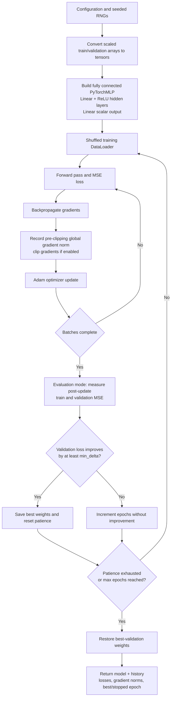

# System architecture

This document describes the current implementation of the DTMB 5415
hull-resistance regression pipeline. The command-line entry point is `main.py`.
The workflow reads the MATLAB dataset, prepares leakage-safe partitions,
compares baseline models with a PyTorch MLP, optionally searches or sweeps MLP
configurations, evaluates selected models on the held-out test partition, and
writes metrics and diagnostic plots.

## Repository components

```text
MMA3001/
├── main.py                   CLI and experiment orchestration
├── data_prep.py              MAT loading, validation, splits, scaling, audit
├── linear_regression.py      Mean and linear-regression baselines
├── neural_network.py         PyTorch MLP, training, metrics, plots, sweep
├── hyperparameter_tuning.py  Optuna TPE search and convergence plot
├── plots.py                  Legacy plotting helpers for notebooks
├── src/
│   └── data_prep.py          Deprecated compatibility wrapper
├── tests/
│   └── test_pipeline.py      Synthetic-data unit and CLI smoke tests
├── check_syntax.py           Parse Python files without writing bytecode
├── requirements.txt          Runtime dependencies
├── requirements-dev.txt      Runtime and test dependencies
└── outputs/                  Default location for generated experiment results
```

The active CLI imports the root-level modules directly. `plots.py` is retained
for older notebooks; the active plotting path is implemented in
`neural_network.py` and `hyperparameter_tuning.py`. The legacy
`src.data_prep` wrapper delegates to the canonical root-level loader and can
optionally export split CSVs.

## Module and dependency architecture

```mermaid
flowchart LR
    User["User / command line"]
    CLI["main.py<br/>argument parsing and orchestration"]
    Prep["data_prep.py<br/>load, validate, split, scale"]
    Baselines["linear_regression.py<br/>mean and linear baselines"]
    Model["neural_network.py<br/>MLP, training, metrics, sweep, plots"]
    Tuning["hyperparameter_tuning.py<br/>Optuna TPE objective and plot"]
    Legacy["src/data_prep.py<br/>deprecated compatibility wrapper"]
    LegacyPlots["plots.py<br/>legacy notebook plotting"]
    Dataset["DTMB5415-database.mat"]
    Deps["NumPy · SciPy · pandas<br/>scikit-learn · PyTorch<br/>Optuna · Matplotlib"]
    Results["Output directory<br/>metrics.json · CSV · PNG"]
    Tests["tests/test_pipeline.py<br/>synthetic MAT data"]
    Syntax["check_syntax.py"]

    User --> CLI
    CLI --> Prep
    CLI --> Baselines
    CLI --> Model
    CLI --> Tuning
    Tuning --> Model
    Prep --> Dataset
    Legacy --> Prep
    CLI --> Results
    Model --> Results
    Tuning --> Results
    Tests --> Prep
    Tests --> Baselines
    Tests --> Model
    Tests --> Tuning
    Syntax -. parses .py files .-> CLI
    LegacyPlots -. legacy notebook use .-> Deps
    Prep -. uses .-> Deps
    Baselines -. uses .-> Deps
    Model -. uses .-> Deps
    Tuning -. uses .-> Deps
```

## End-to-end experiment flow

```mermaid
flowchart TD
    Start(["Run python main.py"])
    Args["Parse CLI options<br/>dataset, target row, seed, output path,<br/>epochs, tuning and sweep options"]
    Validate{"Options valid<br/>and MAT file exists?"}
    Error["Report input error and stop"]
    MakeOutput["Create output directory"]
    Load["Load MATLAB arrays<br/>variablesMatrix and coefStatMatrix"]
    Check{"Required arrays, dimensions,<br/>target row and finite values valid?"}
    DataError["Raise clear data validation error"]
    Orient["Transpose features to samples × features<br/>select requested target coefficient row"]
    Split["Seeded sample-level split<br/>70% train · 10% validation · 20% test"]
    Audit["Audit exact duplicate feature rows<br/>across partitions"]
    Scale["Fit X and y StandardScaler<br/>on training partition only<br/>transform train, validation and test X"]
    SweepChoice{"--sweep enabled?"}
    Sweep["Train preset MLP architectures<br/>using train + validation only"]
    SweepOutputs["Save architecture_sweep.csv<br/>and architecture_sweep.png"]
    Baselines["Fit mean and linear-regression baselines<br/>on training data; calculate validation metrics"]
    TuneChoice{"--skip-tuning enabled?"}
    Fixed["Use fixed MLP configuration"]
    Optuna["Optuna TPE trials<br/>sample layer count, widths, lr,<br/>weight decay and batch size"]
    TrialTrain["Train each trial on training split<br/>early stop using validation MSE"]
    TrialScore["Rank trials by validation MSE<br/>in original target units"]
    OptunaOutputs["Save Optuna convergence plot"]
    Refit["Train selected/fixed MLP on train data<br/>with validation early stopping"]
    Eval["Evaluate final MLP and baselines<br/>on held-out test partition"]
    Metrics["Calculate MSE, RMSE, MAE and R²<br/>in original target units"]
    Plots["Save loss, gradient, prediction,<br/>model-comparison and residual plots"]
    Json["Write metrics.json<br/>configuration, splits, audit, results,<br/>trial and stage runtime"]
    Done(["Report output directory and total runtime"])

    Start --> Args --> Validate
    Validate -- No --> Error
    Validate -- Yes --> MakeOutput --> Load --> Check
    Check -- No --> DataError
    Check -- Yes --> Orient --> Split --> Audit --> Scale --> SweepChoice
    SweepChoice -- Yes --> Sweep --> SweepOutputs --> Baselines
    SweepChoice -- No --> Baselines
    Baselines --> TuneChoice
    TuneChoice -- Yes --> Fixed --> Refit
    TuneChoice -- No --> Optuna --> TrialTrain --> TrialScore --> OptunaOutputs --> Refit
    Refit --> Eval --> Metrics --> Plots --> Json --> Done
```



### Data and model-selection boundary

- The input file is expected to contain 2-D `variablesMatrix` and
  `coefStatMatrix` arrays, with hulls along their columns. The chosen
  coefficient row becomes the regression target.
- The default split is reproducible and sample-level. Feature and target
  standardisers are fitted only on training samples. Test features are
  transformed with the training feature scaler; test targets remain in
  original units and are not passed to tuning or early stopping.
- The optional architecture sweep and every Optuna trial use training samples
  for fitting and validation samples for model selection. Optuna converts the
  best scaled validation MSE to original target units using the fitted target
  scaler's scale.
- The selected (or fixed) MLP is fitted once more. The final test metrics are
  produced only after model selection; they must not be used to choose a
  configuration.

## MLP training lifecycle

`neural_network.train_optimized_mlp` is shared by Optuna trials, optional
architecture-sweep candidates, and the final MLP fit.



The trained model is evaluated using `evaluate_pytorch_model`, which predicts
in scaled target space and applies the training-fitted target scaler's inverse
transform. `regression_metrics` reports MSE, RMSE, MAE, and R². The plotting
helpers save training/validation loss, gradient norms, prediction comparisons,
and residual diagnostics.

## Main interfaces and outputs

| Component | Main interface | Purpose |
| --- | --- | --- |
| CLI | `main()` in `main.py` | Validates options and orchestrates one experiment. |
| Data preparation | `load_and_preprocess_data()` in `data_prep.py` | Returns scaled feature partitions, original and scaled targets, scalers, target metadata, split sizes, and duplicate audit. |
| Baselines | `MeanBaseline`, `train_linear_regression()` | Fit training-only reference models. |
| MLP | `PyTorchMLP`, `train_optimized_mlp()` | Define and train neural regression models with early stopping. |
| Metrics/evaluation | `evaluate_pytorch_model()`, `regression_metrics()` | Predict in original target units and calculate regression metrics. |
| Architecture sweep | `run_architecture_sweep()` | Compare preset hidden-layer layouts using validation MSE. |
| Hyperparameter tuning | `run_bayesian_search()`, `best_model_config()` | Search and return the best Optuna configuration. |

The CLI writes to `--output-dir` (default `outputs/`):

- `metrics.json`: run metadata, split and duplicate audit, settings, stage and
  trial runtimes, plus train, validation, and held-out test results.
- `training_loss.png` and `gradient_norms.png`: final MLP training diagnostics.
  The loss chart shows training loss only and labels the stopping epoch and
  restored validation-selected checkpoint separately.
- `linear_regression_training_predictions.png`,
  `linear_regression_validation_predictions.png`, and
  `linear_regression_predictions.png`: standalone linear-regression predictions
  for the train, validation, and test partitions.
- Paired outlier sensitivity runs may use `--exclude-training-sample` to omit a
  zero-based source index after the seeded split. This preserves validation/test
  membership and records the omitted index in `metrics.json`. Plot titles carry
  `--comparison-label`; dashed actual-versus-predicted diagonals are 1:1 reference
  lines, not model fits.
- `test_predictions.png`, `test_model_comparison.png`, and `test_residuals.png`:
  held-out test diagnostics.
- `architecture_sweep.csv` and `architecture_sweep.png`: optional sweep
  results, only when `--sweep` is enabled.
- `optuna_convergence.png`: search history, only when tuning is enabled.

## Tests and supporting files

`tests/test_pipeline.py` uses small generated MATLAB-format files to test data
validation, split/scaler behavior, duplicate auditing, model training,
hyperparameter validation, metrics, compatibility behavior, CLI arguments,
and an end-to-end smoke run. It does not require the full DTMB dataset.
`check_syntax.py` parses project Python files without writing bytecode.
`requirements.txt` lists runtime packages; `requirements-dev.txt` includes the
runtime requirements and pytest.
